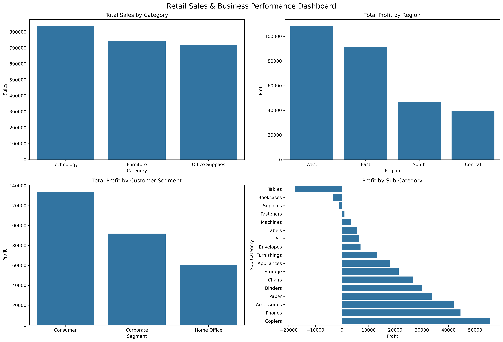

# Retail Sales & Customer Insights Analysis

## Project Overview

This project focuses on analyzing retail sales data to identify business trends, evaluate profitability, and generate meaningful business insights using Python.

The goal is to practice practical Data Analytics skills, including data cleaning, exploratory data analysis (EDA), business KPI calculations, and data visualization.

## Project Objectives

- Understand and clean retail sales data.
- Perform exploratory data analysis using Pandas and NumPy.
- Analyze sales and profitability across different categories.
- Evaluate regional and customer segment performance.
- Investigate the relationship between discounts and profit.
- Create meaningful visualizations using Matplotlib and Seaborn.
- Develop business insights and recommendations.

## Dataset Information

- **Dataset:** Sample Superstore
- **Source:** Kaggle
- **Records analyzed:** 9,977
- **Columns:** 13
- **File:** `SampleSuperstore.csv`

### Dataset Columns

Ship Mode, Segment, Country, City, State, Postal Code, Region, Category, Sub-Category, Sales, Quantity, Discount, Profit.

**Note:** This dataset does not contain Order Date, Order ID, or Customer ID.

## Technologies Used

- Python
- Pandas
- NumPy
- Matplotlib
- Seaborn
- Jupyter Notebook
- Git and GitHub

## Project Structure

```text
Retail Sales Dataset Practice Project/
│
├── data/
│   └── SampleSuperstore.csv
│
├── notebooks/
│   └── retail-sales-dataset.ipynb
│
├── visuals/
│   └── retail_analysis_dashboard.png
│
├── .gitignore
└── requirements.txt
```

## Analysis Performed

1. Dataset inspection and understanding
2. Data cleaning and validation
3. Exploratory Data Analysis
4. Overall sales and profit analysis
5. Category and sub-category analysis
6. Regional performance analysis
7. Customer segment analysis
8. Shipping mode analysis
9. State-wise sales and profit analysis
10. Discount impact analysis
11. Business KPI calculations
12. Data visualization

## Key Business Findings

| Metric | Result |
|---|---:|
| Total Records Analyzed | 9,977 |
| Total Columns | 13 |
| Total Sales | $2,296,195.59 |
| Total Profit | $286,241.42 |
| Total Quantity Sold | 37,820 |
| Average Discount | 15.63% |
| Overall Profit Margin | 12.47% |
| Missing Values | 0 |
| Duplicate Rows | 0 |

### Important Insights

- Technology generated the highest sales and profit among the three product categories.
- The West region generated the highest sales and profit.
- Consumer customers contributed the highest total sales and profit.
- Home Office had the highest customer segment profit margin.
- Tables recorded the largest loss among the sub-categories.
- California and New York were the leading states by profit.
- Higher discount levels were associated with losses in several discount groups.

## Dashboard

The project includes a visual dashboard created using Matplotlib and Seaborn.



## How to Run the Project

1. Clone or download this repository.
2. Create a Python virtual environment.
3. Install the required libraries:

```bash
pip install -r requirements.txt
```

4. Open the Jupyter Notebook:

```bash
jupyter notebook
```

5. Open `notebooks/retail-sales-dataset.ipynb` and execute the cells.

## Limitations

The dataset does not contain Order Date, Order ID, or Customer ID. Therefore, time-series analysis, repeat-purchase analysis, and individual customer behavior analysis are outside the scope of this project.

## Learning Outcomes

Through this project, I practiced:

- Data manipulation using Pandas.
- Numerical analysis using NumPy.
- Data cleaning and validation.
- Exploratory Data Analysis.
- Business KPI calculations.
- Data visualization.
- Interpreting analytical results into business insights.

## Author

**Rajnandini Dhongade**

MCA Student | Aspiring Data Analyst

---

*This project was developed as a practical learning project to strengthen Python-based Data Analytics and business problem-solving skills.*